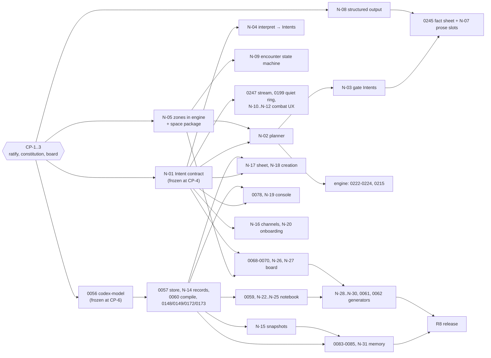

# Plan of action

**Replan 2026-11, Synthesis.** Date 2026-11-06.
**Reads with:** [wishlist.md](wishlist.md), [target-architecture.md](target-architecture.md), [decisions-for-ratification.md](decisions-for-ratification.md) (P-nn), [board-rework-map.md](board-rework-map.md) (N-nn, EP-nn).
**Status:** proposed. Nothing here binds until checkpoint CP-1 passes.

## 1. Sequencing principle

- Sequence by shared foundations, not by goal. The four goals are co-equal (P-01).
- Fix each seam contract before any lane builds against it. A frozen contract is what makes two lanes safe in parallel.
- Every milestone ends in a demo and, where play is involved, a hosted playtest with the auditor.
- Latency is the first foundation to fix, because it gates every play goal (P-14).

## 2. Projects

| Project | Repo | Contents | When |
|---|---|---|---|
| **the-stacks** | this monorepo | Apps, all internal packages, docs, board | Now |
| **dnd5e-engine** (+ `srd`) | stays in monorepo; published to npm at R8 (P-15) | Pure engine, space math dependency, SRD 5.2.1 data, golden-dice tests | Publish at R8 |
| **stacks-adapter-foundry** | new repo, Later | Foundry module over the ws protocol | Only when the P-07 trigger fires |

No other repo split. Internal packages (`intent`, `planner`, `space`, `codex-model`, `session-model`) stay in the monorepo.

## 3. Workstreams

| Id | Workstream | Foundation | Board label |
|---|---|---|---|
| WS-INT | Intent vocabulary and planner | F2 | `ws:intent` |
| WS-SPC | Spatial model | F1 | `ws:space` |
| WS-NAR | Narration around facts, DM runtime | F5 | `ws:narration` |
| WS-COD | Codex and campaign records | F3 | `ws:codex` |
| WS-MEM | Memory and continuity | F4 | `ws:memory` |
| WS-ENG | Engine rules coverage | K2 | `ws:engine` |
| WS-TBL | Table UX: stream, composer, combat, channels | — | `ws:table-ux` |
| WS-SHT | Sheet and character creation | — | `ws:sheet` |
| WS-DMC | Human-DM console | — | `ws:dm-console` |
| WS-NBK | Notebook and editors | — | `ws:notebook` |
| WS-GEN | Generators | — | `ws:generators` |
| WS-BRD | Board (VTT) | — | `ws:board` |
| WS-PLT | Platform, onboarding, release | — | `ws:platform` |
| WS-TLS | Playtest and dev tooling | — | `ws:tooling` |

## 4. Dependency graph and parallel seams

### Seams that make parallel lanes safe

| Parallel pair | Safe once | Why |
|---|---|---|
| WS-INT ∥ WS-SPC ∥ WS-NAR (gateway part) | CP-1 | Disjoint packages; planner consumes `space` only through `SpaceView`. |
| WS-TBL ∥ WS-INT (planner, gate) | N-01 frozen (CP-4) | The UI emits Intents and renders rows from `project()`. It never calls the planner. Use fixture tables (`play/use-fixture-table.ts`). |
| WS-COD ∥ WS-INT, WS-TBL, WS-NAR | CP-1 | The codex is a new plane. It touches the DM runtime only at `compile()`, which lands in 0060 after the codex model freezes. |
| WS-SHT ∥ WS-DMC ∥ WS-TBL | N-01 frozen and 0058 (PC entity) merged | Each surface emits Intents and reads projections. No surface reads another surface's state. |
| WS-NBK ∥ WS-BRD | 0057 (codex API) and N-06 (spatial projection) merged | Notebook writes codex versions; board reads space projections. The only shared object is the `map` entity, owned by 0068. |
| WS-MEM ∥ WS-BRD, WS-GEN | N-14 records and N-15 snapshots merged | Memory reads events and codex; it writes only chronicle drafts through the gate. |
| WS-ENG (any card) ∥ everything | Always, per card | Engine is pure and boundary-linted; each card adds one command or rule with golden-dice tests. |

**Serial-only points:** `session-model` catalog edits and the `gate/proposals.ts` union. Merge them one PR at a time. Sweeps still merge serially.

## 5. Milestone ladder

Milestones replace `m-1`…`m-9`. Board milestone ids are `r-1`…`r-8`. Old milestones archive at CP-3.

| Milestone | Name | Goals | Lane-weeks | Lanes | Calendar (weeks) |
|---|---|---|---|---|---|
| R1 | Fast Table | G1 G3 | 14 | 3 | 5 |
| R2 | Living Codex | G1 G4 | 9 | 2 | 4 (overlaps R1 by 2) |
| R3 | Human Table | G2 G3 | 12 | 3 | 4 |
| R4 | Notebook | G4 | 8 | 2 | 4 |
| — | **MVP complete** (all four goals at minimal depth) | | **43** | | **~15** |
| R5 | The Board | G3 G2 | 10 | 2 | 5 (∥ R4 tail) |
| R6 | Generators | G4 G1 | 10 | 2–3 | 4 |
| R7 | Campaign Memory | G1 G2 | 8 | 2 | 4 (∥ R6) |
| R8 | Release 1.0 | all | 6 | 2 | 3 |
| — | **V1 complete** | | **~77** | | **~29** |

Sizing is ±50%. A lane-week is one implementer lane on a written spec plus its review and merge.

### R1 — Fast Table

**Demo:** one human plus three AI companions fight four goblins in the Greyhollow reed camp, in text with zone chips. Every attack, save and move resolves in code. Fact rows appear in under 1 s. Narration streams after and never blocks the next turn.

**Scope:** N-01–N-13; 0245, 0247, 0199, 0130; engine 0215, 0222, 0223, 0224; platform 0037, 0098, 0101, 0138; tooling 0186, 0231.

**Exit criteria:**
1. p95 time from confirmed Intent to fact rows is under 1 s on the hosted stack.
2. p50 time to first narration token is under 10 s.
3. A full round of 4 PCs and 4 monsters takes under 60 s of wall time.
4. Zero audit-regenerate fallbacks; the audit loop is deleted.
5. Attempt-1 schema failures under 1% across the run.
6. Encounter can end, resume, and drop a fled combatant.
7. **Playtest gate:** runbook R1 combat scenario passes the auditor (N-13).

### R2 — Living Codex

**Demo:** the Greyhollow scene runs from codex entities. The seed JSON files and their loader are deleted. Two sessions of one campaign run back to back. An NPC told a secret in session 1 acts on it in session 2.

**Scope:** 0056, 0057, 0058, 0060, 0148, 0149, 0152, 0172, 0173; N-14, N-15.

**Exit criteria:**
1. `apps/server/seeds/` and `dm/seed/load.ts` are gone.
2. Campaign, table and session rows exist; `routes/tables.ts` reads them.
3. Gate load time is flat across a 5 000-event session (snapshots).
4. Reveals are events; "View as player" shows only revealed blocks.
5. **Playtest gate:** two-session solo run passes the auditor, with the knowledge check.

### R3 — Human Table

**Demo:** three humans play one adventure twice. Run 1 has the AI DM. Run 2 has a human DM in the console, with the AI in `suggest`. Players use the sheet drawer, channels and the combat action bar.

**Scope:** 0053, 0077, 0078, 0093, 0097, 0103, 0121, 0122, 0150, 0178, 0179, 0217, 0219, 0225–0230; N-16–N-21.

**Exit criteria:**
1. A new player goes from invite link to seated character without operator help.
2. A human DM runs a combat using only console controls and DM-control Intents.
3. Table talk never reaches the narrator (test plus playtest check).
4. **Playtest gate:** both runs pass the auditor (TASK-0053).

### R4 — Notebook

**Demo:** a human DM and the AI build a 5-location adventure in the notebook. The AI drafts two NPCs and an encounter; the human edits and curates them. The AI DM plays the adventure with no hand-authored content.

**Scope:** 0059, 0063, 0081; N-22–N-25.

**Exit criteria:**
1. Every MVP entity kind has an editor and a readiness lint.
2. Every AI-authored version shows its author, source and status.
3. Backup and restore round-trip one campaign.
4. **Playtest gate:** the co-authored adventure plays to its end with the AI DM.

### R5 — The Board

**Demo:** the cave fight runs on the board and in text at once. Players drag tokens to draft moves. Fog lifts per room. Darkvision matters. A fireball hits exactly the tokens the engine computes.

**Scope:** 0068, 0069, 0070, 0076; N-26, N-27.

**Exit criteria:**
1. No player client receives an unrevealed token (network inspection test).
2. Every board fact also appears as stream text.
3. Works at 1440 px docked and as a slide-out at 1280 px.
4. **Playtest gate:** one combat played board-first by three humans.

### R6 — Generators

**Demo:** the DM opens the generator desk, generates a five-room dungeon with its encounters and loot, curates it, and the party plays it on the board.

**Scope:** 0061, 0062, 0071, 0079, 0092, 0124, 0126, 0151; N-28–N-30.

**Exit criteria:**
1. Generators write no number the code did not compute.
2. Each draft keeps its generator id and seed; reroll reproduces it.
3. The AI DM can call a generator mid-session through the gate.

### R7 — Campaign Memory

**Demo:** a solo player plays three sessions. Each session opens with an accurate recap. Threads, clocks and attitudes carry over. The chronicle proposes notebook updates after each session.

**Scope:** 0083, 0084, 0085, 0086, 0088, 0089, 0120, 0125; N-31.

**Exit criteria:**
1. Recap accuracy is checked by the multi-session auditor.
2. Turn context stays inside its token budget at session 3.

### R8 — Release 1.0

**Demo:** a stranger self-hosts from public docs and plays a short solo campaign from premise to conclusion.

**Scope:** 0073, 0074, 0080, 0082, 0090, 0091; N-32.

**Exit criteria:**
1. Clean clone to first scene by public docs only.
2. `dnd5e-engine` and `srd` are published with attribution.
3. **Playtest gate:** solo campaign end to end (TASK-0091).

## 6. Frozen in-flight work

| Item | State found | Disposition |
|---|---|---|
| **M3 runbook B** (`docs/design/m3-runbook-b-resolution-quality.md`) and **B2** | Both swept; B2 playtest ran 2026-11-06 (71% combat audit pass). The planned runbook C (opening with TASK-0245) never started. | Mark runbooks B and B2 complete. Do not open runbook C. Its cards re-home per the rework map. Remove the `sweep-m3-runbook-b` worktree after confirming no unmerged commits. |
| **TASK-0186** playtest-run skill (In Progress) | Skill exists and is in use. | Keep. Absorb 0196 and 0235. Finish in R1 as WS-TLS. It produces the R1 playtest gate tooling. |
| **TASK-0199** one chat stream, spec 066 (To Do, 0/61 tasks) | Spec written against `action.declare {text}`. | Rewrite. Quiet ring for exploration only (P-04). Build on the Intent `declared` state. Amend spec 066 after CP-4. R1. |
| **TASK-0203** haiku invalid JSON (In Progress) | Root cause is free-form JSON with tight caps. | Merge into N-08 (structured output). Close 0203 when N-08 merges. Keep its vm-104 log shapes as N-08 test fixtures. |
| **TASK-0247** MUD stream, spec 091 (To Do, 0/28 tasks) | Spec ruled; depends on 0199. | Rewrite. Keep the stream, roll rows and composer baseline. Clickable nouns and ways draft Intent pills. Roll rows render code facts (0245). Absorb 0133, 0162, 0169, 0187, 0190, 0243. Amend spec 091 after CP-4. R1. |
| Stale worktrees under `.claude/worktrees/` (runbook-a, task-0188, runbook-0180-0182) | Parked branches. | Verify each branch merged with `gh api`. Remove merged ones. List unmerged ones for the operator. |

## 7. Operator approval checkpoints

Run them in this order. Each checkpoint records its ruling in a tracked file before work continues.

| # | Checkpoint | What the operator approves | Artifact |
|---|---|---|---|
| CP-1 | Ratify decisions | P-01…P-21 (accept, amend or reject each) | `decisions-for-ratification.md` rulings column; new decision records |
| CP-2 | Constitution | Major-version rewrite of `.specify/memory/constitution.md` | Constitution diff on the branch |
| CP-3 | Board rework | Apply the rework map; archive `m-1`…`m-9`; create `r-1`…`r-8` | Branch board commit |
| CP-4 | Intent contract freeze | N-01 schema, kinds and text grammar | N-01 spec + decision record |
| CP-5 | R1 runbook sign-off | Lanes, merge spine, tiers | R1 sweep runbook |
| CP-6 | Codex model freeze | 0056 kinds, links, visibility, provenance | 0056 spec + decision record |
| CP-7 | R1 playtest gate | R1 exit criteria met | Playtest log |
| CP-8 | UI design rounds | Sheet drawer (N-17), DM console (0078), notebook (0059) directions | `docs/design/<round>/decision.md` each |
| CP-9 | R2 and R3 runbook sign-off | Lanes and merge spine | Runbooks |
| CP-10 | R2 playtest gate | R2 exit criteria met | Playtest log |
| CP-11 | R3 playtest gate (human table) | TASK-0053 passes | Playtest log |
| CP-12 | R4 demo (MVP complete) | All four goals at MVP depth | Demo log; MVP retrospective |
| CP-13 | Board design round | Board layout and gestures (0070) | Design-round decision |
| CP-14 | R5–R7 runbook sign-offs | Per milestone | Runbooks |
| CP-15 | Adapter trigger review | Whether P-07's trigger fired | Note on TASK-0072 |
| CP-16 | Release 1.0 | Tag, README, publish packages | TASK-0082 |
