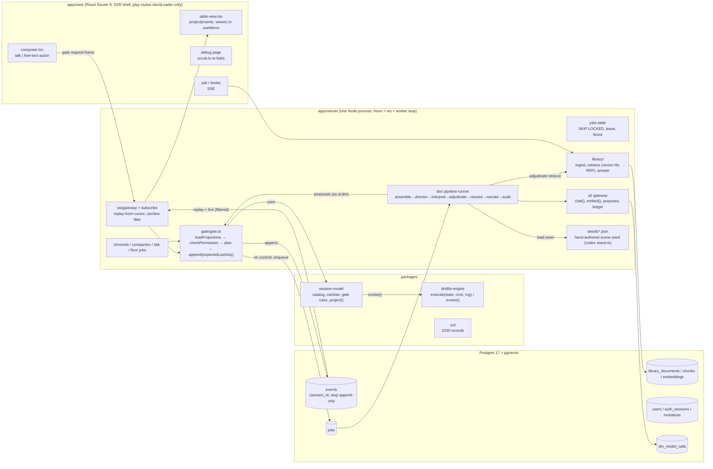

# Architecture audit — the-stacks as built (replan 2026-11)

**Pinned to:** `34a713e6` (replan branch, equal to `origin/main` at brief time).
**Inputs:** `docs/wiki/INDEX.md`, `docs/design/architecture.md` (A1–A14), `docs/design/vision.md`,
`.specify/memory/constitution.md`, decision-0028, and the code.
**Judged against:** the four end goals in `../brief.md` — solo AI campaign, top-notch human table,
first-class text and VTT UX, human+AI co-authored campaign tools.

## 0. Size and stack at a glance

Lines of TS/TSX (src + tests), by module:

| Module | LOC | Note |
|---|---|---|
| `apps/server/src/dm` | 16 648 | DM runtime; `nodes/resolve.ts` alone is 1 967, `gates/plan-gate.ts` 1 060 |
| `packages/session-model` | 13 533 | event catalog, gate rules, projections, fixtures |
| `packages/dnd5e-engine` | 10 400 | pure engine |
| `apps/web/app/play` | 5 059 | text table |
| `apps/server/src/bench` + `playtest` | 8 354 | load bench, playtest harness |
| `apps/server/src/library` | 3 145 | ingest, retrieval, rules answerer |
| `apps/web/app/debug` | 2 982 | operator debug page |
| `packages/srd` | 2 319 | SRD 5.2.1 data |
| everything else (auth, ws, gate, routes, ai, schema) | ~6 000 | |

Versions (package.json): Node 22, pnpm 11.10, Turbo 2.11, TypeScript 5.9, Biome 2.5; server Hono 4.13,
`ws` 8.18, Drizzle 0.45, `pg` 8.23, Zod 4.6; web React 19.3, React Router 8.4 (framework mode,
`ssr: true`), Vite 8.3, Tailwind 4.3, Radix 1.6. **Not installed:** PixiJS (A1 names it), any canvas
library, any editor/form library, any client state library beyond a hand-rolled store.

## 1. Current system map

**The event log.** `apps/server/src/schema/events.ts`: one table, PK `(session_id, seq)`, `type`,
`jsonb payload`, `payload_version`, `visibility` text, append-only trigger. `seq` is assigned under a
per-session `pg_advisory_xact_lock` (`events/log.ts`), with an `expectedLastSeq` optimistic guard.
There is **no sessions, campaigns or tables table** — `routes/tables.ts` derives the table list by
scanning `events` for the latest `party.member.changed`, `dm.seat.changed` and `scene.changed` rows.

**The projection model.** `packages/session-model/src/projections/apply.ts` folds stored events into
`SessionProjections` (transcript, party, actions, proposals, ledger, encounter, and an embedded
`engine: EngineState`). Mechanics events are folded by the engine's own `evolve()`, never re-derived
(apply.ts:112). The same pure `project(events, viewer)` runs:

- on the server, per gate attempt, from seq 0 (`gate/gate.ts:159` → `session/projections.ts`, batches of 200);
- in the browser, on every frame (`play/table-view.tsx:43`, `use-live-table.ts:45`);
- in the debug scrubber (`debug/scrub.ts`).

**Write path.** Every write is a typed `GateRequest` (15 proposal kinds, `session-model/src/gate/proposals.ts`)
routed by policy `auto`/`ask`/`suggest`, DM seat and table-mode commit authority. A committed action
enqueues a turn job; the DM pipeline produces `mechanics` proposals carrying engine commands, which
the gate applies through `execute()` and appends.

## 2. What is sound — keep as the foundation

| Asset | Why it is right for the end goals | Evidence |
|---|---|---|
| **Server-owned append-only log with per-viewer visibility** | The one design that lets a text client, a VTT client, an AI DM and an external adapter share one truth with hidden info. Exactly what goals 2–3 need. | `schema/events.ts`, `events/log.ts`, `session-model/src/visibility.ts`, `ws/subscribe.ts` (gap-free replay→live) |
| **Pure engine `execute(state, cmd, rng) → events \| refusal` + `evolve()`** | Deterministic, seeded, refuse-before-draw, no I/O (boundary-linted). Reusable by any client or a headless sim. The strongest piece of the codebase. | `dnd5e-engine/src/execute.ts`, `scripts/check-boundaries.mjs`, `biome.json` restricted imports |
| **One gate for humans and AI, policy table as autonomy dial** | Goal 2's "human or AI DM" is literally a seat swap (`dm.seat`), not a code path. | `session-model/src/gate/{policy,permissions,seat}.ts`, `apps/server/src/gate/gate.ts` |
| **Projection is a shared pure function** | Client and server compute identical state; fixtures test UI without a server. | `session-model/src/projections/apply.ts`, `play/use-fixture-table.ts` |
| **Provider-agnostic AI gateway with purposes + cost ledger** | BYO models, per-purpose routing, every call costed. | `apps/server/src/ai/`, `schema/dm-model-calls.ts` |
| **Jobs queue with lease + fencing** | Crash-safe turns; same queue for ingest, turns, chronicle, floor. | `schema/jobs.ts`, `dm/jobs.ts`, `dm/worker.ts` |
| **"Script owns numbers" anti-cheat ordering** | Dice before narration; audit + claim gate. This is what makes solo AI play trustworthy. | `dm/pipeline/runner.ts`, `dm/claims.ts`, `dm/gates/plan-gate.ts` |
| **A5 three-section content shape (identity/portrayal/hooks)** | Already proven in seeds; the right contract for AI-playable content. | `dm/seed/schema.ts` |
| **Library plane + cited retrieval** | Grounded adjudication for both the AI DM and a human DM. | `library/retrieve.ts`, `dm/nodes/adjudicate.ts` |
| **Self-hosted single-process topology** | Matches the audience; split is a config change. | A2; `apps/server/src/index.ts` |

## 3. Foundational weaknesses

### 3.1 VTT/battle map sharing state with text chat — **no spatial model anywhere**

- The engine has no positions, grid, distance, reach, movement, cover, area or line of sight.
  `CombatantSchema` (`dnd5e-engine/src/schema/state.ts:249`) holds HP, conditions, slots, stats only;
  attack `range` is an enum `melee | ranged | melee-or-ranged` (state.ts:210).
- The event catalog has none of A4's `token.moved` / `map.revealed`; grep finds no map or token type in
  `session-model/src/events/`. The opportunity-attack `move` step (spec 079) is a narrative step, not
  geometry.
- Consequence: a battle map today would be a second source of truth. Spatial state must enter the
  **engine** (positions as engine state, `move` as an engine command with reach/OA derived) and the
  catalog (map placement, fog reveal as `dm`-visible events) before any VTT client is built. This is a
  data-model change, not a UI task.

### 3.2 Rich UI must emit the same commands as typed text — **today it cannot**

- A player's only write is `action.declare { text, scope, characterId }`
  (`session-model/src/events/actions.ts`, `play/source.ts:43`). There is no structured intent.
- The free text is turned into engine commands only by LLM nodes: `interpret` → `adjudicate` →
  `resolve` (the 1 967-line `dm/nodes/resolve.ts`). `mechanics` proposals (`command: z.unknown()`) are
  DM-only (`gate/permissions.ts` `DM_KINDS`).
- So a "click to attack goblin with longsword" button has nowhere to go except as English text that an
  LLM re-parses. It costs model calls, can be misread, and cannot run under a human DM without the AI
  pipeline or manual DM commands.
- Needed seam: a **typed player intent** layer (`attack {actor, target, entry}`, `move {path}`,
  `cast {spell, targets}`, `check {skill}`) that both a UI control and `interpret` produce, and that a
  deterministic planner turns into engine commands. Free text stays a front end to that layer, not the
  only one. decision-0028 ("one chat stream") moves the opposite way for text, which is fine only if
  this intent layer exists underneath.

### 3.3 Campaign content model — **does not exist; seeds are the codex**

- A3/A5 promise a mutable, versioned **codex** plane. No codex table exists (`apps/server/src/schema/`
  has auth, events, jobs, library, dm-model-calls only). INDEX.md: "No codex … yet."
- Content lives in four ~16 KB hand-written JSON files (`apps/server/seeds/*.json`) read from disk by
  `dm/seed/load.ts:215`, validated by `dm/seed/schema.ts`. The schema is scene-scoped: beats,
  per-beat `presence`, an `opening.premise`, combatants inline. No campaign, location graph, item,
  loot table, dungeon, storyline or encounter entity; no IDs that outlive one scene.
- Four Greyhollow variants (`-duo`, `-trio`, `-reed-camp`) are copies, not compositions — the
  absence of a codex is already producing duplication.
- There is no **campaign** or **table** row at all; a table is an implicit set of `events` rows
  (`routes/tables.ts`). Nothing ties sessions into a campaign, which goal 1 (a full campaign) needs.
- Needed: a codex plane with versioned entities (A5 contracts), typed edges, provenance
  (`human | ai:<purpose>` + generator seed), draft/curated status, and a compile step from codex to
  the DM's scene context. Generators write drafts through the same proposal idea (AI proposes, human
  curates).

### 3.4 Long-campaign memory — **bounded only by a 20-line tail and full replays**

- Context: `assemble` takes `transcript.slice(-TRANSCRIPT_TAIL)`, `TRANSCRIPT_TAIL = 20`
  (`dm/nodes/assemble.ts:24,355`). Chronicle writes ≤3 journal entries per run
  (`dm/chronicle.ts`), but nothing retrieves journal entries back into the turn by relevance; there is
  no embedding of play history, no per-NPC memory, no campaign summary.
- Performance: every gate attempt replays the whole session log from seq 0
  (`gate/gate.ts:159`; the gate's own comment at gate.ts:376 admits "a load here replays the whole log
  once per turn"). The browser also re-folds the full log on each frame. Fine for one scene;
  quadratic-ish over a campaign of thousands of events. Needed: projection snapshots (checkpoint
  `SessionProjections` at seq N) and session boundaries inside a campaign.

### 3.5 Secondary weaknesses

- **Prompt churn as the main fix vector.** Live prompts are at `dm.narrate-v21`, `dm.audit-v16`,
  `dm.interpret-v15`, `dm.director-v10` (`dm/prompts/`). 91 specs; most M3 specs since 064 are
  narration/audit patches. This is the signature of an LLM doing work a deterministic layer should
  own (see 3.2).
- **`dm/` is the gravity well.** 16.6 k LOC in one server folder, mixing pipeline, gates, seed schema,
  doctrine, scripts, floor and talk logic. `resolve.ts` at ~2 k lines is the riskiest file in the repo.
- **Gate rules live in `session-model`, gate I/O in `apps/server/src/gate`.** Good split, but the
  package name hides that it holds the whole rules-of-the-table policy.

## 4. Where the code diverged from the written architecture

| Written | Built | Source |
|---|---|---|
| A1: PixiJS v8 table canvas; shadcn/ui | No PixiJS dependency; Radix + Tailwind only | `apps/web/package.json` |
| A3: three planes, codex = mutable versioned entities | Two planes; codex replaced by JSON seed files | `schema/`, `apps/server/seeds/` |
| A4: catalog includes `token.moved`, `map.revealed` | Absent | `session-model/src/events/` |
| A4: "projections are the state" | True, but recomputed from seq 0 per gate attempt; no snapshots | `gate/gate.ts:159` |
| A10 engine scope "dice, HP, conditions, initiative, death saves, rests, slots" | Grew to stats-derived checks, attacks, six spells, opposition, help, reactions, banded outcomes — good growth, but undocumented in A10 | `dnd5e-engine/src/commands/`, wiki [[dnd5e-engine]] |
| A11 fixed pipeline, two branches | Same order, but with held turns, first-stage cuts, follow-ups, talk turns, react calls, roll resume — a de facto state machine spread over `runner.ts`, `first-stage.ts`, `follow-ups.ts`, `resume.ts`, `talk-turn.ts` | `apps/server/src/dm/` |
| A12 Talk vs Action as two message concepts, group sign-off | decision-0028 replaces with one chat stream + quiet-ring hold window (accepted, not yet built — spec 091 in flight) | `backlog/decisions/decision-0028…` |
| A12 "Talk never triggers a DM turn" | Talk triggers a `talk` turn (decision-0027, spec 065) | `dm/talk-turn.ts`, `dm/talk-triggers.ts` |
| A1 client: "realtime and canvas routes client-only" | Realtime routes are `clientLoader`-only — consistent; there are no canvas routes | `routes/play.tsx:7` |
| Sessions vs campaigns | No first-class session, table or campaign record at all | `routes/tables.ts` header comment |

## 5. Candidate seams

| Seam | Today | Could become | Contract it needs |
|---|---|---|---|
| **5e engine** | `packages/dnd5e-engine`, pure, boundary-linted | Published library / own repo; the most separable thing here | Versioned `EngineCommand` / `EngineEvent` / `Refusal` Zod schemas + `ENGINE_SCHEMA_VERSION` (exists, state.ts:3); add spatial state; golden-dice conformance tests ship with it |
| **SRD data** | `packages/srd` | Published data package | Record schemas + provenance + attribution; engine-shaped stat blocks |
| **Session model (catalog + gate rules + projection)** | `packages/session-model` | Shared package consumed by server, text client, VTT client, adapters | Event catalog with `payloadVersion` upcasters; `project()` + snapshot format; `GateRequest` union including a new typed-intent kind |
| **Typed intent planner** (new) | inside `dm/nodes/resolve.ts` + plan-gate | Deterministic package between UI/LLM and engine | `Intent → EngineCommand[] \| Refusal`, pure; LLM `interpret` targets it |
| **Codex + generators** (new) | seeds JSON | Its own workstream: codex plane (DB + API), generators (donjon-style, deterministic first, AI-assisted), editor UI | A5 entity schemas, typed edges, provenance, draft/curated status, `compile(codex, sceneRef) → SceneContext` |
| **VTT client** (new) | none | Separate app/package in the monorepo first; repo later if an adapter is chosen | Subscribes to the same WS protocol (`ws/protocol.ts`); renders `project()` output + spatial events; emits only `GateRequest`s (intents, moves) |
| **External VTT adapters** (A13) | none | Separate repos (Foundry module, Owlbear extension) | Same WS protocol + auth token; never writes state |
| **AI gateway** | `apps/server/src/ai` | Internal package; little reason to publish | `chat()`, `embed()`, purpose config, cost ledger |
| **DM runtime** | `apps/server/src/dm` | Internal package `@the-stacks/dm` with nodes as modules | `TurnContext → NodeResult`; reads projections + compiled codex context + memory retrieval; writes only proposals |
| **Library** | `apps/server/src/library` | Stay in-server | `retrieve(query) → cited passages` |

## 6. Stack assessment

**Server / data: keep.** Node 22 + Hono + `ws` + Postgres/pgvector + Drizzle + Zod fits a
single-tenant, event-sourced, self-hosted app. Add projection snapshots and codex tables; no stack
change.

**Client for the text table and debug: React 19 + RR8 is fine.** The play routes already run as
`clientLoader` SPA routes inside an SSR shell; SSR buys little here but costs little.

**For a canvas-heavy VTT:** React Router is not the obstacle — the missing pieces are a renderer and
an input model. Recommendation:

- Build the battle map as a **client-only route/module** that owns a PixiJS v8 (WebGL) stage
  imperatively, with React only for overlay UI. Do not drive per-token rendering through React state;
  feed the Pixi scene from `project()` output and a small spatial projection. (`@pixi/react` is optional
  sugar, not required.)
- Keep it in the same app so it shares auth, WS session hook and `session-model`. Decide
  build-vs-embed-vs-adapter separately (the VTT research file); whichever is chosen, the spatial model
  of 3.1 is a prerequisite and is stack-independent.

**For a rich prep-time editor (codex, storylines, dungeons):** RR8 framework mode is a *good* fit —
loaders/actions + forms over a CRUD codex API is exactly what it does well. Add only what is needed:
a schema-driven form layer from the A5 Zod schemas (Zod already installed; RR actions validate
server-side), and a canvas only for the dungeon/map editor, reusing the VTT Pixi module. A graph view
for storylines/relationships can be a later, isolated dependency.

**Verdict:** no stack change is warranted. The architecture problems in §3 are model problems
(spatial state, typed intent, codex, memory/snapshots), not framework problems. Changing frameworks
would not fix any of them.
