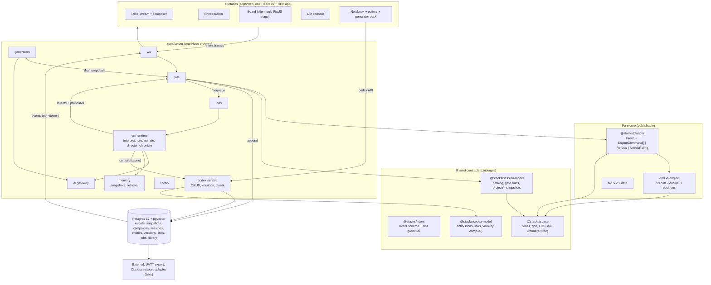
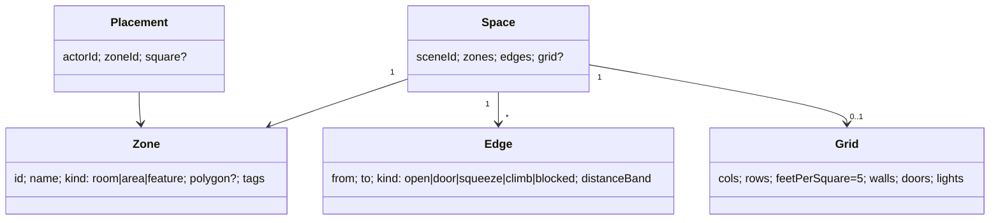
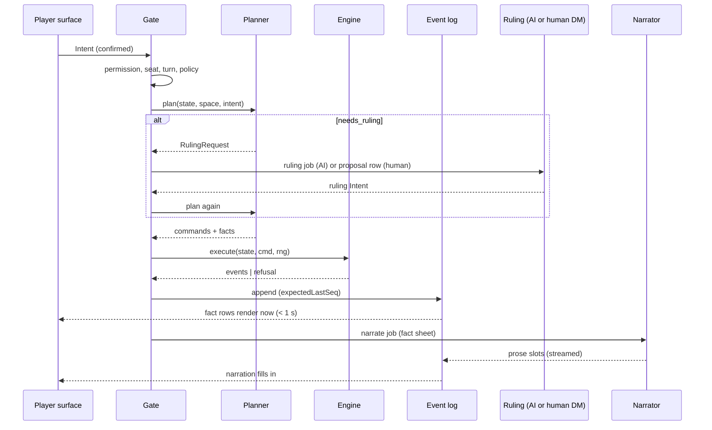
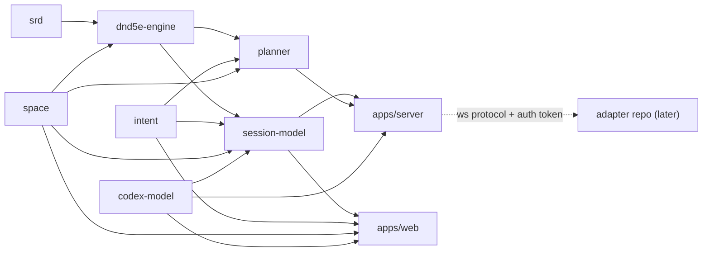

# Target architecture

**Replan 2026-11, Synthesis.** Date 2026-11-06. Pinned against the audit at `34a713e6`.
**Reads with:** [wishlist.md](wishlist.md) (F1–F5, K1–K7), [research/architecture-audit.md](research/architecture-audit.md) (cited as "audit §n").

Delta marks: **[keep]** unchanged; **[extend]** existing code grows; **[new]** no code today; **[replace]** existing code retires.

## 1. Planes and modules



| Module | Delta | Notes |
|---|---|---|
| Event log, visibility, ws replay | [keep] | audit §2 |
| `dnd5e-engine` | [extend] | Adds positions (zone id, optional square), `move`, reach, encounter state machine. |
| `srd` | [extend] | Species, backgrounds, feats, magic items, glossary. |
| `session-model` | [extend] | Adds Intent request kind, spatial and codex-reveal events, snapshot format. |
| `@stacks/intent` | [new] | Package. Schema, commit states, text grammar (slash forms). |
| `@stacks/planner` | [new] | Package. Pure. Takes over the deterministic half of `dm/nodes/resolve.ts` and `gates/plan-gate.ts`. |
| `@stacks/space` | [new] | Package. Zone graph, grid math, LOS, AoE; shared by engine, planner, server and board. |
| `@stacks/codex-model` | [new] | Package. Entity kind schemas (A5 shape), link types, visibility, `compile()`. |
| Codex service + tables | [new] | Replaces `apps/server/seeds/*.json` and `dm/seed/load.ts` **[replace]**. |
| Campaign/table/session tables | [new] | Replaces event scanning in `routes/tables.ts` **[replace]**. |
| Memory: snapshots + retrieval | [new] | Replaces seq-0 replay at `gate/gate.ts:159` and `TRANSCRIPT_TAIL = 20` **[replace]**. |
| DM runtime | [extend] / [replace] | `interpret` emits Intents. `resolve` shrinks to the needs-ruling path. `narrate` writes prose slots. `audit` shrinks to leak + contradiction. |
| AI gateway | [extend] | Structured output (tool-call / JSON schema mode) per purpose. |
| Generators | [new] | Server module; drafts through the gate. |
| Board | [new] | Client-only route module; PixiJS v8 (P-05). |

## 2. The Intent contract (F2)

An Intent is the only way a person or an agent asks the world to change or to speak. Typed text, slash commands, buttons, sheet clicks, map gestures, the AI DM and the human DM all produce it.

```ts
Intent = {
  id: IntentId,
  kind: IntentKind,                 // table below
  actor: ActorRef,                  // pc | npc | dm | ai:dm | companion
  channel?: Channel,                // scene | to:<entity> | dm | party | whisper:<ids>
  targets?: TargetRef[],            // entity | combatant | zone | square | point | room | item
  params?: Record<string, unknown>, // per-kind Zod schema
  text?: string,                    // the player's words, always kept
  source: "composer" | "bar" | "sheet" | "map" | "tracker" | "console" | "ai" | "adapter",
  commit: "draft" | "declared" | "confirmed",
}
```

- `draft` lives only in the client composer.
- `declared` is sent. In exploration the DM may ask for 👍 (quiet ring, P-04).
- `confirmed` goes through the gate to the planner.

### Intent groups and core kinds

| Group | Core kinds | Mutates state? | Resolved by |
|---|---|---|---|
| Speech | `say`, `say_to`, `emote` | No (may trigger a talk reaction) | DM runtime (react) |
| Meta | `ask_dm`, `ooc`, `party`, `whisper` | Never | ask_dm → read-only answer |
| Deed | `attempt` (free-form) | Via ruling | AI or human ruling → planner |
| Check | `check`, `save`, `contest` | Yes | planner + engine; DC from ruling or rule |
| Combat action | `attack`, `cast`, `dash`, `dodge`, `disengage`, `help`, `hide`, `ready`, `search`, `use_object`, `grapple`, `shove` | Yes | planner + engine |
| Movement | `move` (zone, path or square), `stand`, `drop_prone` | Yes | planner + engine + space |
| Reaction | `react` (answers an engine prompt) | Yes | engine |
| Turn control | `end_turn`, `predeclare`, `delay` | Yes | engine |
| Resource | `use_item`, `give`, `equip`, `drop`, `rest_short`, `rest_long`, `concentration_drop` | Yes | planner + engine |
| Roll answer | `roll`, `roll_free` | Only if requested | engine |
| Advancement | `level_choice` | Yes (sheet) | engine + codex |
| DM control | `narrate`, `npc_say`, `request_roll`, `set_dc`, `apply_damage`, `apply_heal`, `apply_condition`, `start_combat`, `end_combat`, `add_combatant`, `move_token`, `reveal`, `ruling`, `pause` | Yes | gate (DM seat only) |
| Session | `bookmark`, `recap`, `retry_narration` (solo, flavour only) | No engine state | DM runtime |

### Planner contract

```ts
plan(state: SessionProjections, space: SpaceView, intent: Intent):
  | { kind: "commands", commands: EngineCommand[], facts: Fact[] }
  | { kind: "refusal", reason: RefusalCode, facts: Fact[] }
  | { kind: "needs_ruling", question: RulingRequest }   // DC, stakes, opposition, adjudication
```

- The planner is pure and deterministic. It never calls a model.
- `needs_ruling` is the only path to a model (AI DM) or a human (DM console).
- A ruling returns as a `ruling` Intent, and the planner runs again with it.

**Delta:** today the only player write is `action.declare {text}` (`session-model/src/events/actions.ts`); `mechanics` proposals carry `command: z.unknown()` and are DM-only (audit §3.2). The new `intent` request kind joins the 15 proposal kinds in `session-model/src/gate/proposals.ts`. `action.declare` survives as the `declared` envelope of an `attempt` Intent during migration.

## 3. Spatial model (F1)

One model at two resolutions. Zones exist in every scene. Squares exist only where a map exists.



- **Range bands without a grid:** `engaged` (same zone, melee), `near` (same or adjacent zone), `far` (two edges), `out` (beyond). The engine checks reach and range against bands.
- **With a grid:** Chebyshev distance, every square 1, difficult terrain 2, no corner cutting past walls (SRD 5.2.1). A zone is a named polygon of squares. A token without a square sits in its zone.
- **AoE:** zone mode uses target-count caps (small 2, medium 3, large 4, huge 8+). Grid mode uses one documented template convention (P-06). The engine, not the renderer, decides who is hit.
- **Hidden information:** placements and zones carry visibility. The server filters per viewer. No client receives an unrevealed token.
- **Events [new]:** `space.defined`, `actor.placed`, `actor.moved`, `zone.revealed`, `map.attached`, `light.set`. Today the catalog has none (audit §3.1, A4 divergence).
- **Engine [extend]:** `CombatantSchema` (`dnd5e-engine/src/schema/state.ts:249`) gains `placement`. Attack `range` enum (`state.ts:210`) gains numeric reach and range.

## 4. Codex model (F3)

Generic entity base with a typed payload (Kanka pattern), versioned, linked, visible per block.

```mermaid
erDiagram
  CAMPAIGN ||--o{ TABLE : hosts
  CAMPAIGN ||--o{ ENTITY : owns
  TABLE ||--o{ SESSION : plays
  SESSION ||--|| EVENT_RANGE : "covers seq range"
  ENTITY ||--o{ ENTITY_VERSION : "append-only"
  ENTITY ||--o{ LINK : from
  ENTITY ||--o{ LINK : to
  ENTITY ||--o| ENTITY : "parent (containment)"
  ENTITY_VERSION ||--o{ BLOCK : contains
  BLOCK }o--|| VISIBILITY : has
```

### Entity kinds

| Tier | Kinds |
|---|---|
| MVP | `pc`, `npc`, `location` (nested: region → settlement → site → room), `encounter`, `item`, `clue` (also `secret`), `session` |
| V1 | `faction`, `quest` (storyline with nodes), `dungeon` (location subtree + MapPlan), `loot_table`, `map` |
| Later | `timeline_event`, `handout`, `random_table` |

Every kind has a small **playable core** (fields the AI DM needs, A5 identity/portrayal/hooks) plus free prose blocks. A readiness lint blocks the "ready for play" status, never saving.

### Link types

| Type | From → to | Notes |
|---|---|---|
| `contains` | location → location/room | Containment is the parent edge, not a generic link. |
| `located_in` | npc/item/encounter → location | |
| `member_of` | npc → faction | |
| `knows` | npc → clue/entity | Seeds the knowledge ledger. |
| `relation` | npc ↔ npc/pc | Label + attitude; mirror optional. |
| `points_to` | clue → node | Three Clue lint counts inbound edges. |
| `features_in` | entity → quest | |
| `holds` | pc/npc/location → item | |
| `uses_map` | location/dungeon → map | |
| `mentions` | any → any | Derived from `@` mentions; backlinks. |

### Visibility and reveal

- Visibility sits on every block and on chosen fields: `dm` | `party` | `pc:<id>[]`.
- A reveal is an event `info.revealed {entityId, blockId|field, to}` on the session log (decision-0026 generalised). It is never a toggle.
- "View as player" is the fold of reveals for that player.
- **Provenance:** each version stores `author: human:<user> | ai:<purpose>`, `source: manual | generator:<id>@<seed> | chronicle:<session>`, `parent`, `status: draft | curated`.
- **Authoring by AI:** generators and chronicle write `draft` versions through the gate as prep-time proposals. Policy `ask` for a human DM; `auto` for an AI-only campaign.

### Compile

`compile(codex, sceneRef, viewer) → SceneContext` loads the scene location, present NPCs, active encounter and in-scope clues **by graph neighbourhood**, then splits a DM view from a player view. It replaces `PlayerSeedView` and the seed loader.

**Delta:** no codex table exists; content is four ~16 KB JSON seeds; no campaign/table/session row (audit §3.3).

## 5. Memory and continuity (F4)

| Layer | What | Store | Read by |
|---|---|---|---|
| Typed state | Knowledge ledger (who met whom, who knows which clue), NPC attitude per PC, clocks, quest status | Projections from events | planner, narrate, interpret, director |
| Snapshots | `SessionProjections` checkpoint every N events and at session close | `snapshots` table | gate, ws subscribe, browser load |
| Chronicle | Per-session journal entries and recap, as events + codex `session` entity | events + codex | recap, retrieval |
| Retrieval | Hybrid FTS + vector over chronicle, journal and notebook prose, filtered by visibility before ranking | library index (reused) | assemble, `ask_dm`, NPC recall |

- Facts that change play are typed state, never retrieval (decision-0026 stands).
- Retrieval is recall and flavour only.
- **Delta:** gate replays from seq 0 per attempt (`gate/gate.ts:159`); `assemble` reads the last 20 lines (`dm/nodes/assemble.ts:24`); nothing retrieves journal entries (audit §3.4).

## 6. The turn pipeline



| Stage | Owner | Model call? | Target |
|---|---|---|---|
| Intent from text | `interpret` (AI) or grammar (slash) | Only for free text | < 3 s |
| Gate | code | No | ms |
| Plan | planner | No | ms |
| Ruling | AI DM or human | Only on `needs_ruling` | AI < 5 s |
| Engine | engine | No | ms |
| Fact rows | code (F5) | No | **< 1 s end to end** |
| Narration | narrator | Yes, streamed | first token < 10 s |
| Check | leak + contradiction (code first, model last) | Rarely | async; a failure appends a correction, never blocks play |

### Narration around facts (F5)

- The narrator receives a **fact sheet**: the restate target, the facts the ledger settled, the speakers, and slot names.
- Code renders every fact row (dice, damage, life state, condition, State line). The model writes no digit and no state (decision-0021 extended).
- The four-part reply (TASK-0245) becomes a template: restate (model slot), describe (model slot), ask (model slot, optional), State (code).
- The audit loop (regenerate → fallback) retires. Narration that names an unrevealed id or contradicts a fact is replaced by its fact rows plus a short code line.
- **Delta:** `dm.narrate-v21` / `dm.audit-v16` and the lexical claim gate (`dm/claims.ts`) police free prose today; first-attempt audit pass 43–71% (inventory B §4).

## 7. Projections

All projections fold the same events with `project(events, viewer)` from a snapshot.

| Projection | Consumer | Contents | Delta |
|---|---|---|---|
| Text stream | table route | Rows: speech, deed, fact, roll, reaction, proposal, OOC, whisper, room block, State line | [extend] `play/table-view.tsx` |
| Board | board module | Space view (zones, grid, placements, fog, lights) per viewer | [new] |
| Sheet | sheet drawer | PC engine state + codex `pc` entity | [new] |
| DM console | console route | DM-visibility stream, proposal inbox, compiled scene context, clocks | [extend] proposals UI exists in part |
| Notebook | notebook routes | Codex entities, latest curated version, per-viewer blocks | [new] |
| AI context | DM runtime | Compact text of space facts (distance, reach, LOS), scene context, retrieved memory | [extend] `assemble` |
| External | UVTT, Obsidian, adapter | Read-only, per-viewer or public view; adapters emit Intents only | [new] |

## 8. Package and repo seams



| Seam | Location | Contract | Versioning |
|---|---|---|---|
| `srd` | monorepo; publish at R8 (P-15) | Record schemas + provenance + CC-BY attribution | semver |
| `dnd5e-engine` | monorepo; publish at R8 (P-15) | `EngineCommand`, `EngineEvent`, `Refusal` Zod schemas, `ENGINE_SCHEMA_VERSION`; golden-dice conformance tests ship with it | semver; schema version in events |
| `space` | monorepo package | `SpaceView`, `distance()`, `inReach()`, `los()`, `aoeTargets()`; renderer-free | internal |
| `intent` | monorepo package | `Intent` schema, per-kind params, text grammar round-trip (`toText`, `parse`) | `INTENT_SCHEMA_VERSION` |
| `planner` | monorepo package | `plan()` signature above; pure | internal |
| `session-model` | monorepo package | Event catalog + `payloadVersion` upcasters; `project()`; snapshot format; `GateRequest` union | internal |
| `codex-model` | monorepo package | Kind schemas, link types, visibility, `compile()` | `CODEX_SCHEMA_VERSION` per kind |
| Server ↔ clients | ws protocol (`ws/protocol.ts`) | Intent frames in; per-viewer events out; replay from cursor | protocol version |
| Codex API | HTTP (RR loaders/actions) | CRUD, versions, links, reveal | — |
| External adapter | separate repo (Later) | ws protocol + scoped token; read projections, write Intents only | protocol version |

**Rule at every seam:** the downstream side may only depend on the published schema, never on a sibling's internals. `scripts/check-boundaries.mjs` gains entries for the new packages.

## 9. Stack

- Keep Node 22, Hono, `ws`, Postgres 17 + pgvector, Drizzle, Zod, React 19, React Router 8, Tailwind 4, Radix (audit §6).
- Add PixiJS v8 for the board only, client-only route, React for overlays (P-05).
- Add no client state library; the hand-rolled store plus `project()` stays.
- Decision-0008 is kept. SSR stays for the shell and the notebook; play and board routes stay `clientLoader`-only.
